<div align="center">

# Apex Motor House

**A full-stack car dealership inventory system, built test-first.**

Node.js · TypeScript · Express · Prisma · SQLite · React · Tailwind CSS

[**Live demo**](https://apex-motor-store.onrender.com/) · [**API health**](https://apex-api-z6iy.onrender.com/api/health)

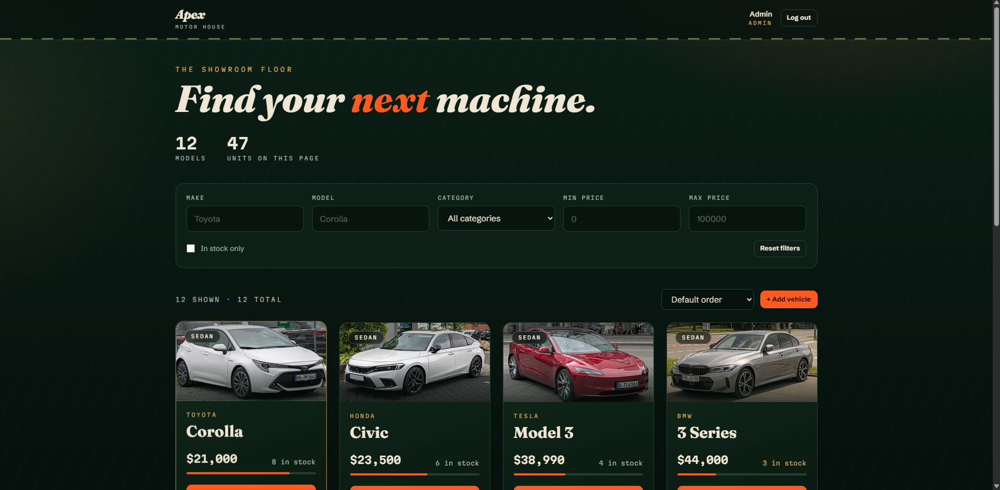

</div>

---

## Table of contents

1. [Overview](#overview)
2. [Try it live](#try-it-live)
3. [Features](#features)
4. [Screenshots](#screenshots)
5. [Architecture](#architecture)
6. [API reference](#api-reference)
7. [Getting started](#getting-started)
8. [Environment variables](#environment-variables)
9. [Testing and TDD](#testing-and-tdd)
10. [Design decisions](#design-decisions)
11. [Deployment](#deployment)
12. [My AI Usage](#my-ai-usage)
13. [Credits](#credits)

---

## Overview

Apex Motor House lets customers browse a dealership's stock, search and filter it, and purchase vehicles. Admins can add, edit, delete and restock vehicles. The backend is a REST API with JWT authentication and a real SQLite database. The frontend is a single-page React app styled with Tailwind.

The project was built for the **TDD Kata: Car Dealership Inventory System**. Every backend feature was written **test-first**, and the Git history shows the Red, Green, Refactor cycle for each one.

## Try it live

| | |
|---|---|
| **Website** | https://apex-motor-store.onrender.com/ |
| **API** | https://apex-api-z6iy.onrender.com |
| **Admin login** | `admin@example.com` / `admin1` |
| **Customer login** | Click **Create an account** on the login page. It takes about 10 seconds. |

> **Heads up:** the app runs on Render's free tier. The first request after a period of inactivity can take up to a minute while the API wakes up. The free disk also resets on restart, so the database is rebuilt on every start with the admin account and 12 demo vehicles. Any data you add may disappear later; that is expected.

## Features

**Customers**
- Register and log in (JWT, 1-day tokens)
- Browse all vehicles, with photos found automatically
- Search by make, model, category and price range
- Sort by newest, oldest, price or make, and page through results
- Purchase a vehicle. The button is disabled when stock is zero.

**Admins**
- Add, edit and delete vehicles
- Restock vehicles
- Override the photo with a custom image URL, or clear it to search again

**Engineering**
- Test-driven backend with 98 automated tests
- Safe stock handling: eight simultaneous buyers can never oversell five cars
- Passwords hashed with bcrypt; helmet security headers; rate limiting on login and register
- Automatic vehicle photos from Wikipedia, with graceful fallback artwork
- Responsive design, with staggered load animations that respect `prefers-reduced-motion`

## Screenshots

| Login | Admin dashboard |
|---|---|
| 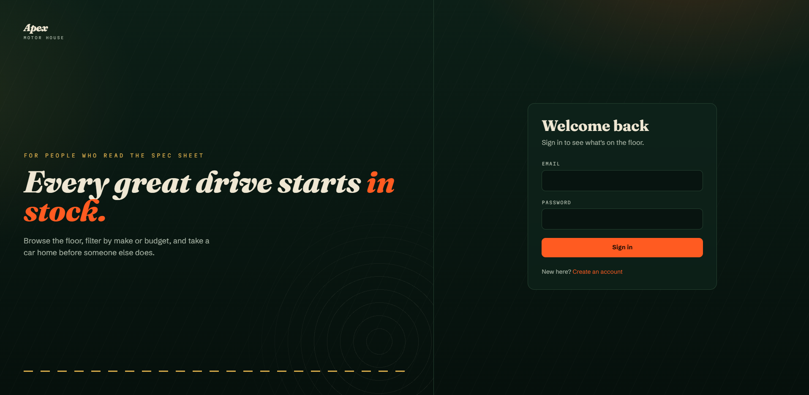 |  |

| Search and sort | Sold out (button disabled) |
|---|---|
| 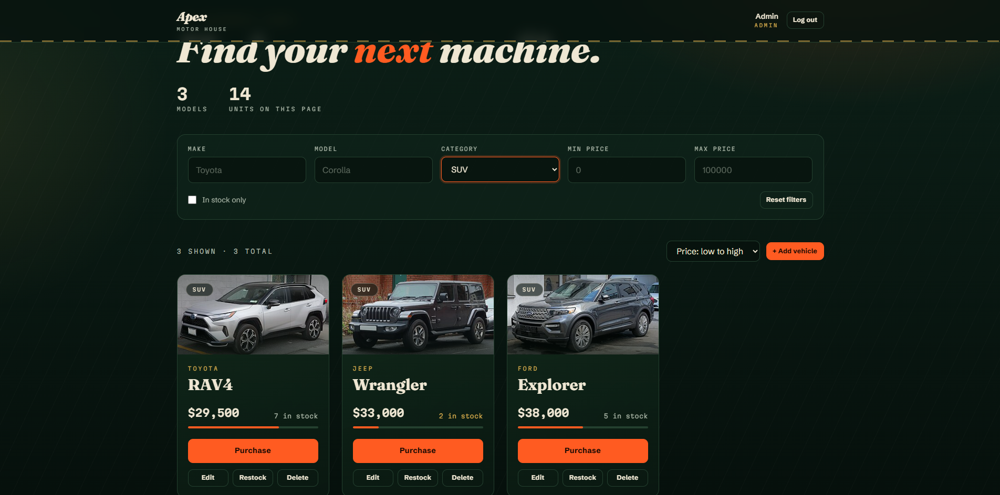 | 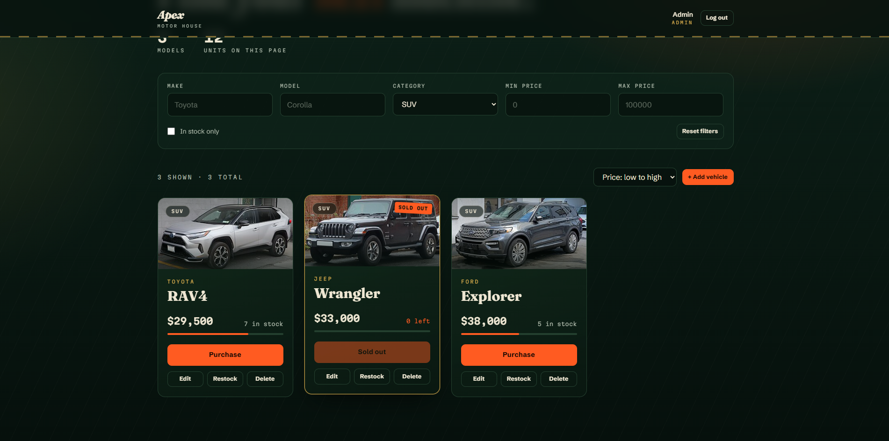 |

| Add vehicle (admin) | Customer view (no admin tools) |
|---|---|
| 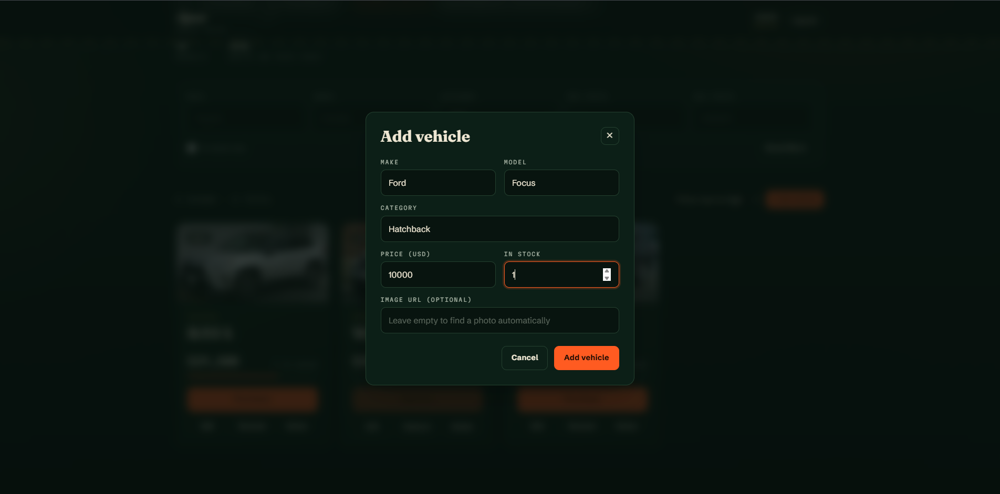 | 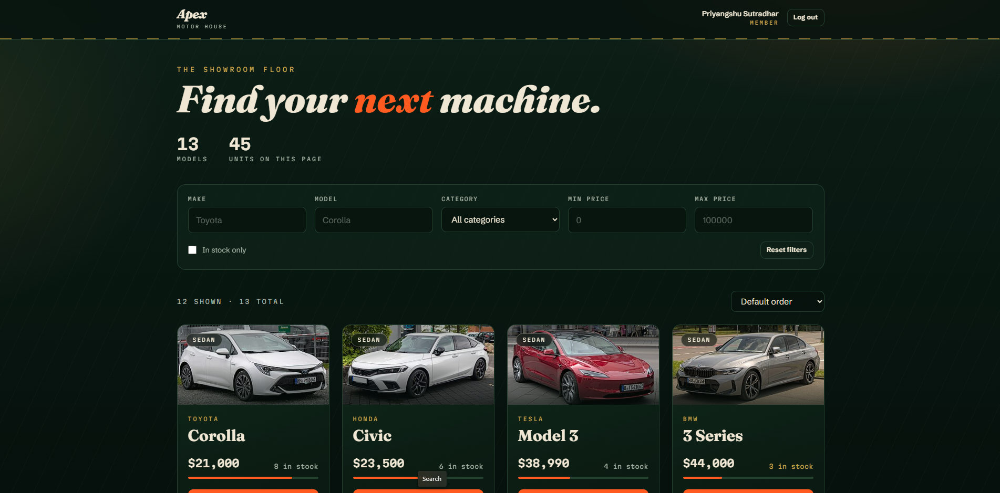 |

<p align="center">
  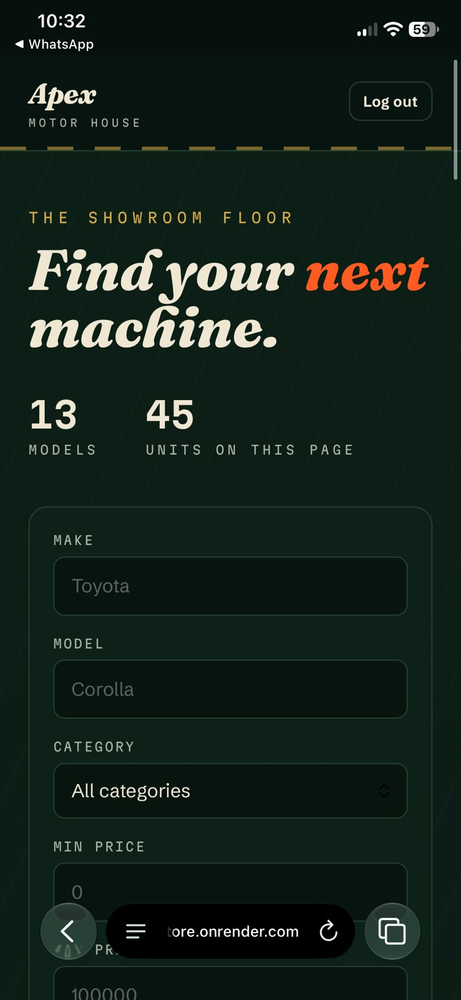
</p>

## Architecture

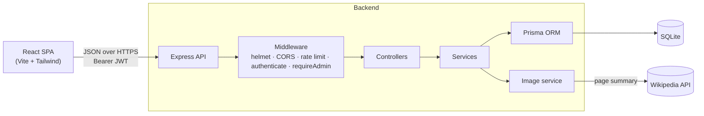

Each request passes through small, single-purpose layers:

| Layer | Responsibility | Folder |
|---|---|---|
| Routes | Which URLs exist, and which middleware guards them | `backend/src/routes` |
| Middleware | Authentication, admin check, rate limiting, error handling | `backend/src/middleware` |
| Controllers | Read the request, call a service, send the response | `backend/src/controllers` |
| Services | Business rules (stock handling, search, image lookup) | `backend/src/services` |
| Validation | Check and clean all input before it reaches a service | `backend/src/validation` |
| Prisma | Database access | `backend/prisma` |

### Data model

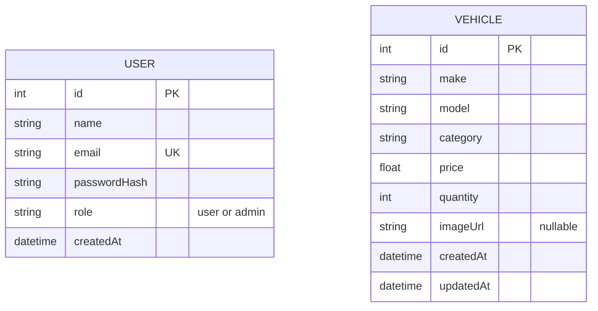

### Project structure

```
car-dealership/
├── backend/
│   ├── prisma/            schema.prisma and migrations
│   ├── src/
│   │   ├── controllers/   HTTP handlers
│   │   ├── services/      business logic (auth, vehicles, tokens, images)
│   │   ├── validation/    input checking
│   │   ├── middleware/    auth, admin, rate limiter, error handler
│   │   ├── routes/        URL maps
│   │   ├── scripts/       one-off scripts (seed admin, backfill images)
│   │   ├── bootstrap.ts   startup seeding for hosts with a resetting disk
│   │   ├── app.ts         Express app (exported for tests)
│   │   └── server.ts      starts the server
│   └── tests/             Jest + Supertest suites
├── frontend/
│   └── src/
│       ├── api/           fetch client and typed endpoints
│       ├── auth/          login state (React context)
│       ├── components/    cards, search bar, modals, pager, toast
│       └── pages/         login, register, dashboard
└── docs/screenshots/
```

## API reference

Base URL: `http://localhost:4000` locally. Protected routes need the header `Authorization: Bearer <token>`.

| Method | Endpoint | Access | Description |
|---|---|---|---|
| `GET` | `/api/health` | Public | Health check |
| `POST` | `/api/auth/register` | Public, rate limited | Create a customer account |
| `POST` | `/api/auth/login` | Public, rate limited | Returns `{ token, user }` |
| `GET` | `/api/auth/me` | Logged in | The current user |
| `GET` | `/api/vehicles` | Logged in | List vehicles (supports `sort`, `page`, `limit`) |
| `GET` | `/api/vehicles/search` | Logged in | Filter by `make`, `model`, `category`, `minPrice`, `maxPrice` (plus `sort`, `page`, `limit`) |
| `POST` | `/api/vehicles` | Logged in | Add a vehicle (photo is looked up if no `imageUrl` is given) |
| `PUT` | `/api/vehicles/:id` | Logged in | Partial update |
| `DELETE` | `/api/vehicles/:id` | **Admin** | Delete a vehicle |
| `POST` | `/api/vehicles/:id/purchase` | Logged in | Buy `quantity` (default 1); `409` if not enough stock |
| `POST` | `/api/vehicles/:id/restock` | **Admin** | Add `quantity` units |

**List response**
```json
{
  "vehicles": [{ "id": 1, "make": "Toyota", "model": "Corolla", "category": "Sedan",
                 "price": 21000, "quantity": 8, "imageUrl": "https://..." }],
  "pagination": { "page": 1, "limit": 12, "total": 12, "totalPages": 1 }
}
```

**Sort values:** `newest`, `oldest`, `price_asc`, `price_desc`, `name`. `limit` is 1 to 50 (default 12).

**Errors** always look like `{ "error": "message" }` with a fitting status: `400` invalid input, `401` not logged in, `403` not an admin, `404` not found, `409` out of stock, `429` too many attempts.

## Getting started

**Requirements:** Node.js 22 (or any current LTS) and npm.

### 1. Backend

```bash
cd backend
npm install
cp .env.example .env        # Windows PowerShell: Copy-Item .env.example .env
# edit .env: set JWT_SECRET, ADMIN_EMAIL and ADMIN_PASSWORD
npx prisma migrate dev      # creates the SQLite database
npm run seed:admin          # creates the admin account
npm run dev                 # API on http://localhost:4000
```

Optional: add demo data by setting `SEED_DEMO_DATA=true` in `.env` before `npm run dev`, or add cars through the admin UI. To fetch photos for existing cars, run `npm run backfill:images`.

### 2. Frontend

In a second terminal:

```bash
cd frontend
npm install
npm run dev                 # http://localhost:5173
```

In development, Vite forwards `/api` calls to port 4000, so no extra configuration is needed.

### 3. Log in

Open http://localhost:5173. Log in with the `ADMIN_EMAIL` and `ADMIN_PASSWORD` from your `.env` to see the admin tools, or register a new account for the customer view.

## Environment variables

**Backend (`backend/.env`)**

| Variable | Purpose |
|---|---|
| `DATABASE_URL` | SQLite file, for example `file:./dev.db` |
| `JWT_SECRET` | Secret used to sign tokens. Use a long random string. |
| `PORT` | API port (default `4000`) |
| `ADMIN_EMAIL`, `ADMIN_PASSWORD` | Admin account created by `seed:admin` and at startup |
| `SEED_DEMO_DATA` | `true` adds 12 demo vehicles into an empty table at startup |
| `FRONTEND_URL` | Allowed browser origin (CORS). Unset allows any origin. |
| `AUTH_RATE_LIMIT_MAX` | Login/register attempts per 15 minutes per IP (default `10`) |

**Frontend**

| Variable | Purpose |
|---|---|
| `VITE_API_URL` | API address for deployed builds. Empty in development. |

## Testing and TDD

Run the backend suite:

```bash
cd backend
npm test                 # all tests
npm run test:coverage    # with a coverage table
```

Tests use a **separate SQLite file** (`test.db`) that is reset before each run, so they never touch development data. Network calls are blocked in tests, and the Wikipedia lookup is mocked.

### Test report

| | |
|---|---|
| Test suites | 17 passed |
| Tests | 98 passed |

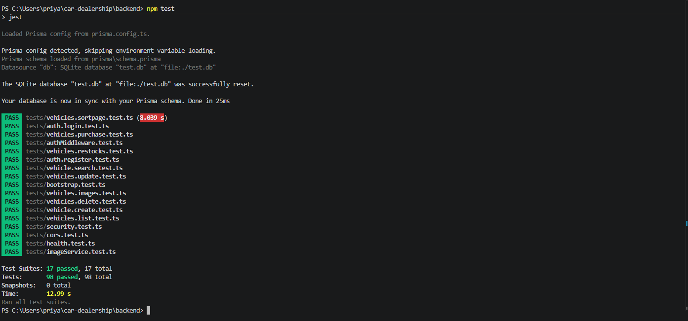

**Coverage**

```
TODO: paste the table printed by `npm run test:coverage` here
```

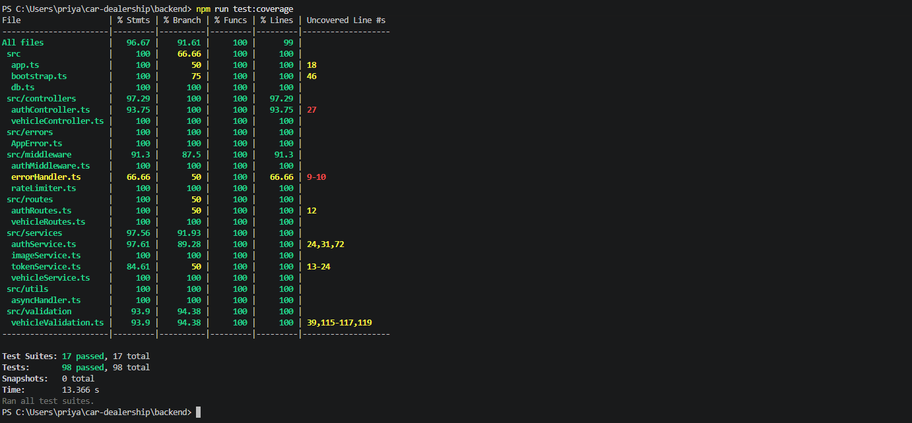

### What is covered

- **Auth:** registration rules, hashed passwords, duplicate emails, login, token contents, expired and tampered tokens
- **Authorisation:** every admin-only route is checked for a `403` as a normal user
- **Vehicles:** create, list, search, partial update, delete, with validation edge cases
- **Inventory:** purchase and restock, including out-of-stock and **eight simultaneous buyers for five cars**
- **Sorting and pagination:** every sort option, page boundaries, bad input
- **Images:** the Wikipedia lookup, including every failure path
- **Security:** helmet headers and the rate limiter
- **Startup:** admin creation, demo seeding, CORS origin lock

### Red, Green, Refactor

Every feature follows the same three commits. Browse the history with `git log --oneline`:

```
feat: add admin-only restock endpoint
test: add failing tests for restocking vehicles (admin only)
feat: add purchase endpoint with atomic stock decrement
test: add failing tests for purchasing vehicles
refactor: extract search filter builder and consolidate vehicle service
...
```

## Design decisions

- **Stock changes are atomic.** Purchase is a single SQL update, "subtract only if enough stock". Reading, checking and then writing would let two buyers both take the last car. A test fires eight parallel requests at five cars and expects exactly five successes.
- **Layered backend.** Controllers stay thin, services hold the rules, validation is separate. Each file has one job, which keeps it testable and follows SOLID.
- **Admins are never created through the API.** `POST /register` always makes a regular user. Admin accounts come from environment variables, so nobody can promote themselves.
- **Same error for unknown email and wrong password** on login, so attackers cannot discover which emails exist.
- **Image URLs accept only `http(s)`**, so values like `javascript:` can never reach an ``.
- **Photo lookup is best effort.** A slow or failed lookup never blocks saving a vehicle; the card falls back to artwork.
- **Wikipedia instead of scraping car sites.** It needs no API key, has a stable public API, and most photos are freely licensed.
- **Purchase is an inventory operation, as the kata specifies.** There are no payments, orders or invoices. A production system would add an `Order` table, a payment provider such as Stripe with webhooks, and stock reservation while payment is pending.
- **"In stock only" filters the current page in the browser.** Moving it to the server would be a natural next step.

## Deployment

Both services run on [Render](https://render.com), deployed from this repository.

**API (Web Service)**
- Root directory: `backend`
- Build: `npm install --include=dev && npx prisma generate && npm run build`
- Start: `npx prisma migrate deploy && node dist/server.js`
- Environment: `NODE_VERSION`, `DATABASE_URL=file:/tmp/apex.db`, `JWT_SECRET`, `ADMIN_EMAIL`, `ADMIN_PASSWORD`, `SEED_DEMO_DATA=true`, `FRONTEND_URL`

**Frontend (Static Site)**
- Root directory: `frontend`, build `npm install --include=dev && npm run build`, publish `dist`
- Environment: `NODE_VERSION`, `VITE_API_URL`
- Rewrite rule `/*` to `/index.html` so refreshing on `/login` works

Because the free disk resets, the server recreates the admin account and demo vehicles on every start (`backend/src/bootstrap.ts`). For permanent data, move to a hosted database such as Postgres, which is a small Prisma change.

## My AI Usage

### Tools used

- **Claude (Anthropic)** was the only AI tool I used, in one long conversation for the whole project. The full log is in [`PROMPTS.md`](PROMPTS.md). Every AI-assisted commit carries a `Co-authored-by` trailer.

### How I used it

- **Planning:** broke the kata into steps and chose the stack (Node, TypeScript, Express, Prisma, SQLite, Jest).
- **Tests first:** Claude drafted the test files for each feature, and I ran them to confirm they failed before accepting the implementation. I reviewed the cases and edge cases.
- **Implementation:** Claude wrote service, controller, validation and middleware code layer by layer, and I ran, read and tested each piece.
- **Design decisions:** discussed the atomic stock update, 409 for out-of-stock, admin accounts coming from environment variables, and using Wikipedia instead of scraping.
- **Frontend design:** I asked for a distinctive look (no default fonts, a committed palette, staggered animation, layered backgrounds) and Claude produced the React components and theme. I removed the pulsing logo dot because I didn't like it.
- **Debugging and deployment:** pasted terminal errors and Render logs and applied the fixes.

### Where the AI was wrong, and how I caught it

I kept a list of the problems, because they say more than the successes:

- **Prisma and Node version clash.** The first Prisma 5 install crashed on my newer Node. I reported the error, and we moved to Prisma 6.
- **Missing Red commit.** My history had no separate test commit for the update endpoint. I spotted this when reviewing `git log`, and we split the commit with an interactive rebase.
- **Wrong sort order in generated code.** The `name` sort was written as descending even though the test expected A to Z. We caught it by reading the code against the test and corrected it.
- **Stray compiled files.** A failed `tsc` build wrote `.js` copies of my tests next to the `.ts` files, so Jest ran every suite twice (150 tests instead of 75). I noticed the doubled count, deleted the files, restricted Jest to `*.test.ts`, and ignored them in Git.
- **Config mistakes.** A missing comma in `package.json` and `tests` wrongly included in `tsconfig` for the production build. Both were fixed from the error messages.
- **File name typo.** `security.tests.ts` would have been silently skipped by the test runner. Found by reading the test list.
- **Deployment checks.** I verified `prisma.config.ts` was tracked and moved Prisma packages into `dependencies` before deploying.

### Reflection

AI made me much faster at the repetitive parts: boilerplate, test scaffolding and CSS. It was weaker at keeping a large project consistent across many messages, so most of my bugs were mismatches between files it had generated at different times. The habits that helped most were running the tests after every step, reading `git log` and test counts critically, and never accepting a step until it was green. I also learned that TDD works well with AI: a failing test written first is a precise, checkable specification, so I could tell quickly whether generated code was right.

## Credits

- Vehicle photos come from **Wikipedia and Wikimedia Commons** through the public Wikipedia REST API, under their respective free licences. Each photo belongs to its original author.
- Fonts: [Fraunces](https://fonts.google.com/specimen/Fraunces), [Schibsted Grotesk](https://fonts.google.com/specimen/Schibsted+Grotesk) and [Martian Mono](https://fonts.google.com/specimen/Martian+Mono), via Google Fonts.
- Built with Express, Prisma, Jest, Supertest, React, Vite and Tailwind CSS.